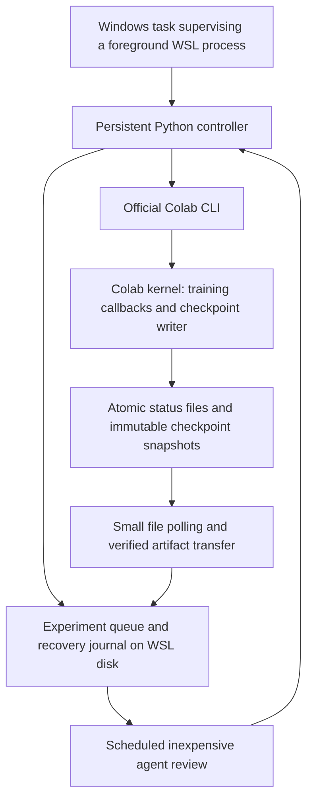

# Autonomous Colab Pro training from WSL

Research checked November 17, 2026. This is an implementation design, not a
running monitor. No Google authentication, remote allocation, or training was
performed while preparing it.

## Recommendation

Use Google's official `google-colab-cli` from WSL, supervised by a persistent
local controller. Use a browser for Google consent and occasional inspection.
Keep training recoverable through verified checkpoints outside the Colab VM.
Run deterministic health checks every minute and ask an inexpensive agent for
short reviews every 20 minutes initially, extending to hourly after stability.

Confirmed user constraints: Colab **Pro**, Windows can remain awake overnight,
and hardware suitability takes precedence over minimizing compute cost. There
is no requested spending ceiling. Existing compute-unit balance and hardware
availability still constrain execution; purchasing units is a separate action.

Google announced its official CLI on June 5, 2026. It supports agent workflows,
and its current session documentation says backend liveness follows active
kernel work. A continuously foregrounded browser tab is therefore unnecessary
for the proposed CLI path. This does not override Colab reclamation policies.
[Announcement](https://developers.googleblog.com/en/introducing-the-google-colab-cli/),
[session lifecycle](https://github.com/googlecolab/google-colab-cli/blob/02d2321c38dd215b7804eebf78b61d98b856bcd3/docs/01_session_management.md).

## What Colab does and does not promise

| Constraint | Consequence for this system |
| --- | --- |
| Limits, idle thresholds, and accelerator availability vary; they are not fully published. | Never promise an exact Pro idle timeout, A100 availability, or uninterrupted completion. |
| Google's FAQ says notebooks generally run for at most 12 hours, depending on usage and availability. | Divide the campaign into resumable jobs. A 16-hour campaign budget cannot be treated as one guaranteed session. |
| Pro+ documents background execution for up to 24 hours with sufficient units. Ordinary Pro does not have that same documented feature. | Do not confuse the browser subscription feature with the CLI's active-kernel lifecycle. |
| Exhausting compute units can terminate a paid runtime. | Read actual balance/rate and preserve enough time to commit results. |
| VM storage disappears when the VM is reclaimed. | A checkpoint only under `/content` is not durable. |

These limits come from Google's [Colab FAQ](https://research.google.com/colaboratory/faq.html)
and [paid-plan guide](https://colab.research.google.com/notebooks/pro.ipynb).
Browser connection loss, kernel failure, and VM reclamation are separate events.
The controller must distinguish them before deciding to restart anything.

If browser operation is needed as a fallback, exclude Colab from Chrome's
Memory Saver. That reduces browser tab discarding; it does not extend Google's
runtime lifetime. No simulated clicking, fake activity, or account rotation is
part of this design.
[Chrome guidance](https://support.google.com/chrome/answer/12929150).

## Hardware confirmed from this checkout

Both current VQA reports and all twelve per-run summaries record
`NVIDIA A100-SXM4-40GB`. Executed notebook outputs report about 39.5 GiB visible
device capacity. No L4 record was found in the inspected notebook sources,
text outputs, or current run records. This does not rule out an earlier L4 run
elsewhere.

| Current setting | Batch size | Recorded peak PyTorch allocation |
| --- | ---: | ---: |
| Frozen, asymmetric | 2,048 cached examples | 4.492 GiB |
| Frozen, parallel matched symmetric | 2,048 cached examples | 7.858 GiB |
| Fine-tuned, asymmetric | 128 | 6.894 GiB |
| Fine-tuned, parallel matched symmetric | 128 | 7.107 GiB |

Evidence: the `*_history.json`, `*_summary.json`, and `*_config.json` files in
[frozen metrics](../outputs/results/frozen_encoder/metrics/) and
[fine-tuned metrics](../outputs/results/unfrozen_encoder/metrics/).

These are allocated-memory peaks over recorded epochs, not reserved memory,
total device use, feature-extraction peaks, or requirements of the new controls.
An [L4 has 24 GB](https://www.nvidia.com/en-us/data-center/l4/), so it is a
plausible candidate to benchmark, not a demonstrated replacement.

Prefer A100 for the first campaign and all controlled timing comparisons.
Verify actual GPU name, total/free VRAM, system RAM, and disk after allocation;
`--high-mem` requests system RAM, not additional VRAM. Preflight every requested
architecture through forward, backward, optimizer update, validation, and
checkpoint write with the intended batch and precision. Measure allocated,
reserved, and device memory. Do not automatically shrink batches or move a
resumed run onto another GPU. The present resume check rejects a different GPU
name or different Torch/Transformers version.

## Turn reviewer requests into a dependency queue

The authoritative scope is
[Reviewer_Questions_and_Responses.md](../Reviewer_Questions_and_Responses.md).
Its current VQA focus supersedes older revision checklists from other checkouts.
Keep proposed experiments separate from manuscript changes already supportable
on CPU.

| Priority | Reviewer items | Job family and prerequisite |
| --- | --- | --- |
| 0 | R1-1, R1-5, R2 major 6 | Establish code/data provenance; recover current parallel checkpoints; benchmark all fusion controls on one GPU, including synchronized forward/training latency, memory, and FLOPs with operator coverage. |
| 1 | R1-1, R2 minor e | Train the conventional one-shared-block and alternative two-block sequential shared controls, seeds 7/42/123, frozen first. This is six new frozen runs; repeat all six under fine-tuning to support both settings. |
| 2 | R1-7, R2 minor d | Train question-only and image-only baselines with the same target/vocabulary/split/selection recipe and paired seeds. Start frozen; record parameters and which encoder components are trained. |
| 2 | R1-7, R2 minor d | Run image-question derangements excluding same-image pairings; documented counterfactuals; missing-modality diagnostics across matched current checkpoints. These are inference jobs. |
| 3 | R1-8 | Compute token-length statistics on CPU, then test longer question limits through explicitly separate inference-only and retraining jobs; rebuild frozen text features when needed. |
| Optional | R1-3, R2 major 4 | Directional/component-sharing experiments, shared-parameter gradient similarity, and descriptive directional maps. Conservative wording already offers a route to address these comments without all these runs. |
| Optional | R1-5 | Additional paired seeds to improve uncertainty over training runs. |

Do not launch CLEVR/Flickr30k reconstructions from guessed implementations.
The response document identifies missing original records for mixed requests.
Recover those before defining any corresponding jobs.

Current parallel checkpoints are absent from `outputs/results/`; the eleven
local `.pt` files under `artifacts/runs/` belong to the older sequential
experiment and cannot substitute. The repository has no `data/` directory.
Dataset/cache locations and the matching current checkpoints still need to be
located. Recovery may avoid unnecessary retraining.

Each queue entry must record the reviewer item, architecture, encoder setting,
seed, immutable code/config/data/cache fingerprints, GPU/environment policy,
validation selection rule, dependencies, and required artifacts. Completion of
one seed must not mark a three-seed comparison complete.

## Controller architecture



Use one controller lease per campaign and one active training request per
kernel. A notebook cell already running training occupies the kernel; sending
another `colab exec` health cell may merely queue it. Poll small status files
through file transport instead. The CLI's file commands use the Jupyter
Contents API, separately from code execution.
[File transport](https://github.com/googlecolab/google-colab-cli/blob/02d2321c38dd215b7804eebf78b61d98b856bcd3/docs/03_file_management.md).

Do not equate `colab status` BUSY/IDLE with verified process health: its documented
status is CLI bookkeeping. Real progress must come from training callbacks.

The controller runs independently of this conversation. A chat subagent alone
is not an installed scheduler. For durable review, the controller invokes a
fresh, short-lived `codex exec` review using a verified inexpensive model
available to this account, a bounded telemetry bundle, a structured response,
and a read-only sandbox. The local CLI exposes `--model`, `--sandbox`,
`--output-schema`, and `--output-last-message`. Validate the actual model ID and
unattended authentication during setup rather than assuming the chat's model
names map directly to CLI access.

Review agents report evidence and recommendations. The controller executes
only defined recovery actions. Scientific changes to architecture, data,
precision, batch, horizon, or selection become new fingerprinted runs, never
silent repairs to an existing experiment.

## Health checks and adaptive agent reviews

Training callbacks update `last_progress_at`, optimizer step, epoch, phase,
examples processed, loss, learning rate, gradient/scaler diagnostics, and
validation progress. A separate writer records process heartbeat, GPU/RAM/disk
telemetry, exception details, and the most recent durable checkpoint receipt.
A live writer thread without advancing training steps is not healthy training.

Write status to a temporary file and replace it locally so a poll cannot read
half a JSON document. Include campaign/job/attempt IDs, a monotonic sequence,
remote timestamps, and controller receipt time. Reject status from an old
attempt. Record both the checkpoint saved locally and the checkpoint verified
outside the VM; they can differ.

| Phase | Deterministic checks | Inexpensive agent review |
| --- | --- | --- |
| Setup and first batches | Every 60 seconds; immediate exception/NaN/OOM events | At launch/preflight and around minute 5 |
| Early training | Every 60 seconds | Every 20 minutes |
| Settling | Every 60 seconds | Every 40 minutes |
| Stable | Every 60 seconds | Every 60 minutes |
| Restart, new architecture/phase, abnormal result | Immediate event and every 60 seconds | Immediate review; reset to early cadence |

Initial stability rule: three consecutive healthy 20-minute reviews, advancing
optimizer steps, at least one completed training/validation epoch and verified
resumable checkpoint, finite metrics, and no unresolved memory/storage issue.
Then require two healthy 40-minute reviews before moving to hourly. This is a
starting policy to tune from real epoch durations.

The one-minute checker retains fast failure detection even after agent review
backs off. A review returns health classification, supporting observations,
recommended action, and next review interval; it does not read the full history
or inspect screenshots on every pass.

Treat two or more missed heartbeat polls over roughly five minutes as an
incident to investigate, not immediate proof of VM death. Detect training
stalls using progress age and a phase-specific threshold, initially the larger
of five minutes or five times observed slow-step time. Downloads, compilation,
feature caching, validation, and checkpoint transfer need distinct progress
counters and thresholds. GPU utilization alone cannot distinguish these phases.

## Checkpoint durability and recovery

The existing notebooks already save model, optimizer, scheduler, AMP scaler,
random states, config, and history, and resume at epoch boundaries. Preserve
that implementation first. A new runtime can repeat the unfinished epoch with
the recorded data order; it cannot currently resume at an arbitrary step.

The minimal persistent destination is WSL disk on the awake Windows machine.
This avoids requiring Drive authorization again on each replacement Colab VM.
Mirror each immutable epoch snapshot promptly. Keep latest and previous full
resume snapshots, the selected best model, configuration, history, vocabulary,
and validation subset identifiers. Optional Drive/GCS replication can add a
second destination after its own access path is configured.

Large full-training checkpoints require testing: about 221 million float32
trainable parameters plus two Adam moment buffers already imply roughly
2.65 GB before other checkpoint contents. Do not assume a multi-GB JSON/base64
Contents API download is reliable. Implement bounded-size shards (for example
128 MiB), per-shard hashes, and a full-file manifest; transfer and verify each
shard, then reassemble and verify the full SHA-256 on WSL. Benchmark this path
before training. A separately validated streaming SSH or object-storage path
can replace sharding if throughput warrants it.

Mark a checkpoint durable only after the remote completion manifest, local
transfer, size/hash checks, and a load/resume compatibility check pass. Retain
the previous verified checkpoint until its successor is usable. Do not assume
rename on a mounted cloud filesystem establishes remote durability.

Epoch snapshots provide a recovery objective of the latest successfully
mirrored epoch, not zero lost work. If a measured epoch is too expensive to
repeat, implement step-boundary resume separately: sample/batch position,
sampler order, RNG, optimizer/scheduler/scaler, and accumulation-boundary
semantics must all be tested. A timer that only saves model weights every ten
minutes does not provide equivalent resume behavior.

## Lifecycle and permitted recovery actions

Use states `PREFLIGHT`, `RUNNING`, `VERIFYING`, `COMPLETE`, `RECOVERING`,
`WAITING_FOR_RESOURCE`, and `NEEDS_USER`. Persist each transition on WSL disk.

1. Validate inputs and dependencies before allocating. Read current assignments
   and reconcile the controller's own known session before requesting a new one.
2. Allocate an explicit named A100 session; verify actual hardware. Pin the
   selected Torch/Transformers environment and remeasure runtime/storage speed.
3. Stage data on local VM storage. Prefer archives/caches over reading thousands
   of JPEGs from a mounted Drive. Keep persistent copies outside the VM.
4. Run preflight and the initial resume test. Begin only a job/epoch expected to
   fit inside the remaining session allowance with export reserve.
5. Launch one training execution and monitor status/files separately. On
   connection loss, first reconcile assignment, heartbeat, checkpoint and job
   identity. An execution client exiting does not establish that training stopped.
6. For a healthy live kernel, observe/reconnect without launching duplicate
   training. For a confirmed lost VM, provision a replacement only when resources
   permit, restage files, and resume the latest verified compatible checkpoint.
7. Back off on resource rejection with bounded retries. Stop retrying for auth
   consent, exhausted units, incompatible environment, persistent code errors,
   or absent data; surface the actual blocker. Never rotate accounts or attempt
   to defeat Colab quotas.
8. Require explicit completion status, expected seed/epoch counts, loadable
   checkpoints, predictions/metrics, and verified local copies. Then export the
   execution record and stop the controller-owned VM.

Use a conservative initial session planning target of about ten hours from
allocation, with at least an hour of headroom for finishing work and export.
This is a scheduling heuristic, not a promised lifetime. Start no new epoch
unless measured epoch time plus checkpoint/transfer reserve fits. The existing
16-hour campaign budget remains a campaign-level value across sessions.

A low or flat validation score may be a scientifically valid result. Report it;
do not tune or stop one architecture selectively. OOM recovery must also
preserve the paired experimental protocol rather than quietly reducing a batch.

## CLI details that matter for correctness

The CLI was installed in `/tmp/acma-colab-cli-research` for local inspection;
the installed distribution reports version `0.8.0`. Its generated command
definitions support explicit session names, `exec --timeout`, `exec --env`,
GPU allocation, file operations, and `usage`. Pin the tested installation and
record dependencies rather than upgrading during a campaign.

The installed execution implementation documents a **30-second silence timeout**
by default. Use `colab --auth=adc exec -s NAME --timeout 0 -f ENTRYPOINT.py` for
training and let the independent watchdog detect stalls. This disables the
CLI's output-silence limit, not Google's runtime limits.
[Execution timeout design](https://github.com/googlecolab/google-colab-cli/blob/02d2321c38dd215b7804eebf78b61d98b856bcd3/docs/02_execution_and_interactive.md).

Important observed trap: the installed `exec_command` records remote error
outputs without necessarily raising or exiting nonzero. A local mock returning
a remote `ValueError` confirmed normal return. Avoid treating CLI exit zero as
experiment success, and avoid blindly running every notebook cell after a
failed prerequisite. Use a fail-fast Python entrypoint/notebook executor and
explicit phase/completion markers, then verify all expected outputs.
[Execution source](https://github.com/googlecolab/google-colab-cli/blob/02d2321c38dd215b7804eebf78b61d98b856bcd3/src/colab_cli/commands/execution.py).

Prefer an explicit persistent session over `colab run` for the first campaign:
the latter normally tears its VM down on return, including failure paths,
which is undesirable before we have recovered diagnostics and artifacts.
[Run lifecycle](https://github.com/googlecolab/google-colab-cli/blob/02d2321c38dd215b7804eebf78b61d98b856bcd3/docs/05_run_command.md).

## One-time human setup

`gcloud` and `codex` are already installed in this WSL environment. Python is
3.14.4, satisfying the Colab CLI's Python >=3.12 requirement. A browser is not
installed on the inspected WSL PATH, and this chat's browser-access host was
unavailable. The proposed terminal route does not require that browser host.

Use the existing Windows browser for the documented copy-and-paste OAuth flow;
installing and signing into a separate WSL browser is unnecessary for that step.
Use the Google account that holds Colab Pro. The proposed ADC setup command is:

```bash
gcloud auth application-default login --no-launch-browser \
  --scopes=openid,https://www.googleapis.com/auth/cloud-platform,https://www.googleapis.com/auth/userinfo.email,https://www.googleapis.com/auth/colaboratory
```

The user completes Google's consent and pastes its code into their own terminal.
Keep credentials outside the repository. This grants local ADC credentials;
browser login alone does not authenticate the CLI. Verify with
`colab --auth=adc sessions` and `colab --auth=adc usage` before allocation.
`colab auth` is a separate, interactive VM-side GCP authentication command, not
a fix for missing local CLI credentials. `drivemount` is also interactive, so
mandatory per-runtime Drive mounts would limit unattended recovery.
[Colab authentication](https://github.com/googlecolab/google-colab-cli/blob/02d2321c38dd215b7804eebf78b61d98b856bcd3/docs/04_automation_and_utility.md),
[gcloud browser flow](https://docs.cloud.google.com/sdk/gcloud/reference/auth/application-default/login).

Keep Windows plugged in, awake, and online. Install a Windows Task Scheduler
entry that runs the WSL controller in the foreground and restarts it after
failure/logon. Keep the WSL invocation attached to that task. A `tmux` session
helps terminal continuity but is not protection from host sleep or reboot;
Microsoft also notes that systemd services alone do not keep WSL alive.
[WSL guidance](https://learn.microsoft.com/en-us/windows/wsl/systemd).

The remaining human input is the storage location of datasets/caches and
matching current checkpoints. External notifications are optional; start with
a local status/report artifact and choose a user-facing destination separately.

## Implementation order and acceptance criteria

Proposed files, not yet created:

- `tools/colab/runner.py`: named-session lifecycle, leases, queue, recovery journal.
- `tools/colab/telemetry.py`: training progress, heartbeat, resource and error records.
- `tools/colab/artifacts.py`: immutable snapshots, bounded transfers and receipts.
- `tools/colab/review.py`: scheduled bounded read-only agent review and escalation.
- `experiments/reviewer_campaign.yaml`: exact reviewer-to-job map and dependencies.
- `runs/colab/<campaign>/`: ignored operational logs, state, local artifacts and reviews.

Before relying on unattended execution, demonstrate:

1. Local CLI authentication and unattended repeated status/usage calls, including
   token refresh; authenticated Colab compatibility remains untested this turn.
2. One small CPU job with explicit success and deliberate remote failure. Confirm
   the controller catches remote failure even if the CLI returns zero.
3. A sufficiently large checkpoint transfer, interruption, retry and hash check.
4. A real short GPU job through training, validation, complete snapshot transfer,
   fresh-kernel resume and preserved optimizer/scheduler/RNG state.
5. A client disconnect with no duplicate work; a deleted runtime recovered from
   WSL artifacts; a corrupt latest checkpoint falling back to the previous one.
6. A simulated NaN, stale-progress, disk-full, and unavailable-GPU event, each
   resulting in the intended bounded recovery or clear blocker.
7. Demonstrated 20-to-40-to-60-minute review transitions and reset on an anomaly.
8. Controller restart reconstructing the correct running/completed jobs, and
   successful output verification before VM release.

Only then start the frozen shared-control campaign, followed by its paired
fine-tuning extension and the inference/unimodal queue. The present deliverable
is the researched design and local CLI checks; the controller, training changes,
authenticated probes, and ongoing monitoring remain to be implemented.
